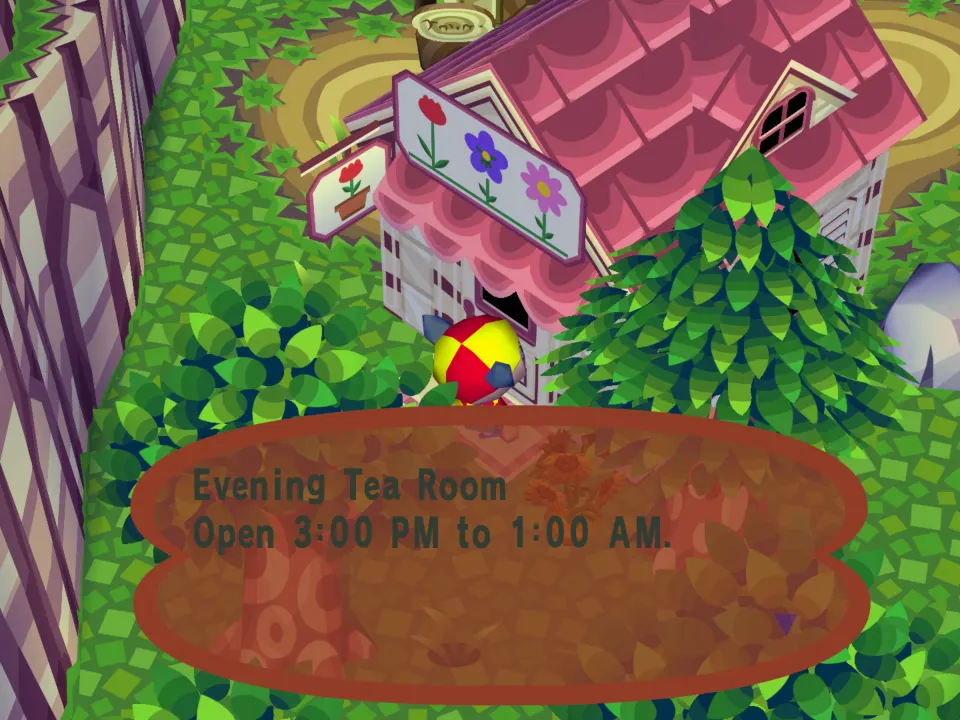
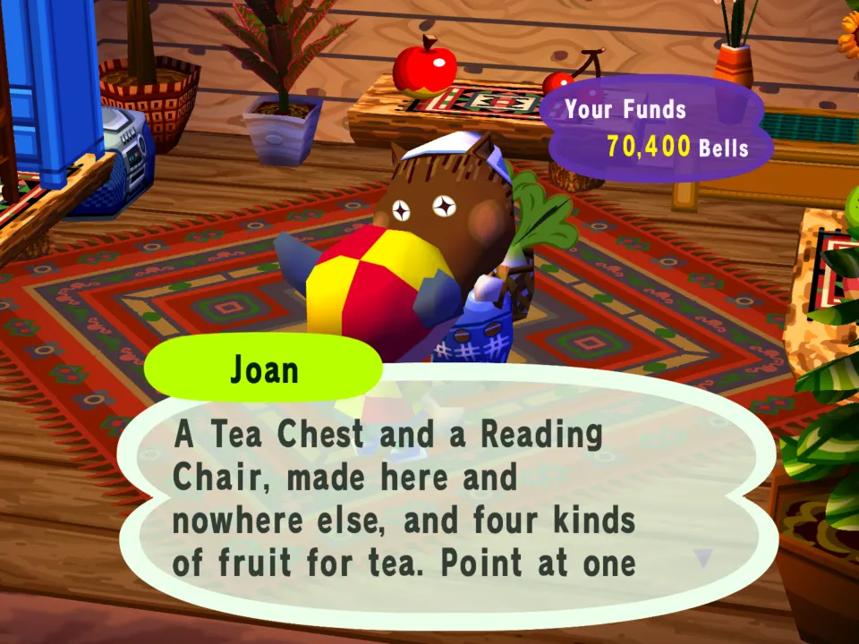
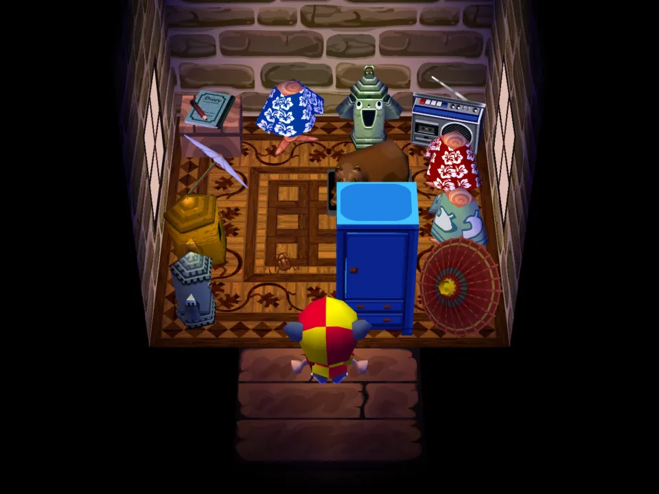

# Evening Tea Room

A World mod (`"scope": "world"`) in two halves:

- **The shop** (`shops.json`, `messages/en.json`): in the evening the flower
  shop becomes the Evening Tea Room, with its own sign, hours, greeting and
  goods.
- **The furniture** (`items.json`): two pieces of furniture of the mod's own,
  a Tea Chest and a Reading Chair, sold in that shop.

A shop changes the town, so the mod is a World mod.

## In the game

At noon the flower shop's door stays shut and its sign is the mod's: Evening Tea Room, open 3:00 PM to 1:00 AM.

Inside at 6 PM: the west bench holds the mod's Tea Chest and Reading Chair, and the other tables four fruits at the mod's prices.

Ask Joan what's in stock and she answers with the mod's stock line.

Bought and put in your room through the pocket menu: the blue chest in the middle is the mod's Tea Chest.

The film (click the picture): Knocking at noon gets the Evening Tea Room sign and its hours; in the evening the shop is open with the mod's furniture and fruit, and Joan greets you and answers what's in stock with the mod's words.

## The shop

`shops.json` gives the flower shop a name, hours, a greeting, an answer to
"What's in stock?" and six goods with prices.

- `hours` is 15:00 to 01:00. Hours can only shorten the shop's own, and a
  close past midnight is fine. Outside them the door stays shut and its sign
  shows the name and the hours.
- The flower shop has six table spots, so it sells at most six goods. Here they
  are the mod's two items and four fruits.
- A good may be an item of the same mod, named by its full id,
  `example.evening-tea-room:tea-chest`. Without a `price` it takes the item's own price
  from `items.json`. The fruits have a price of their own.

`messages/en.json` holds one line, `hours`. Other mods can read it as
`example.evening-tea-room:hours`, with `message("example.evening-tea-room:hours")` in a
script, so a villager could tell you when the tea room opens.

## The furniture

`items.json` lists the new items. Each has an `id`, a `name`, a `price`
and a `base`: the game's own piece it is built on. The base is what the
player sees and what the game saves. The mod's id is kept beside it.

- With the mod installed, the piece is the mod's item, with its own name.
- Remove the mod and the piece stays in the house as the plain base piece.
- Put the mod back and it is the mod's item again.

Other files name an item as `example.evening-tea-room:tea-chest`: the mod id, a
colon, and the item id. Never change an item's id once players have it. To
rename one in a later version, map the old id to the new one with `"renames"`
in `mod.json`.

## Install

In Play AC Online, open the Mods tab. Evening Tea Room is in the mod list as an
official example: install it from there. Or download its ZIP from the
[cookbook](https://playaconline.com/modding/cookbook/) and add the file in the
Mods tab.

## Make your own

This repository is one mod, laid out the way the GitHub import wants it:
`mod.json` at the top, and a tag named for the version in `mod.json`.

1. Copy the repository to your own account.
2. Change `"id"` in `mod.json` to your own, like `yourname.evening-tea-room`.
   Ids that start with `example.` are kept for these examples, so the import
   refuses them.
3. Tag the commit with the version, like `v1.0.0`.
4. In the Mods tab, choose Import from GitHub and paste
   `github.com/<you>/<repository>@v1.0.0`.

To keep only one half, delete the other half's files and its lines in
`mod.json`, and `playac-mod check` tells you if anything still points at them.

The modding guide is at [playaconline.com/modding](https://playaconline.com/modding/).

`media/` holds the pictures and the film the cookbook shows, with their
captions in `media/media.json`. `.playac/screenshots/` holds the listing's
screenshots. The pack rule leaves the pictures, the film and the screenshots
out of the mod.

## License

MIT, see [LICENSE](LICENSE).
