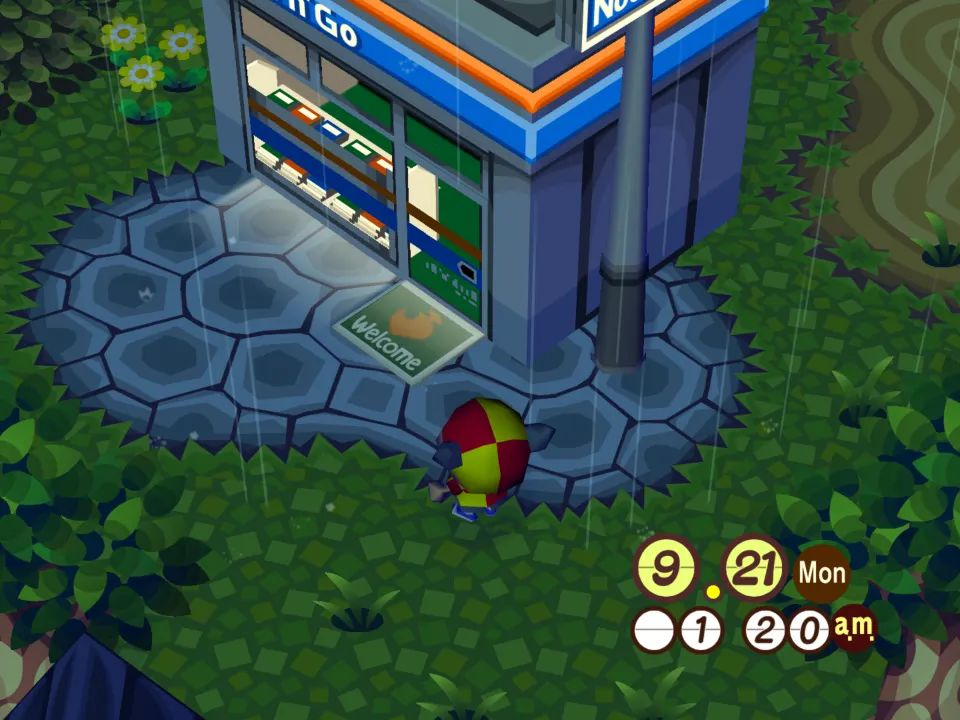
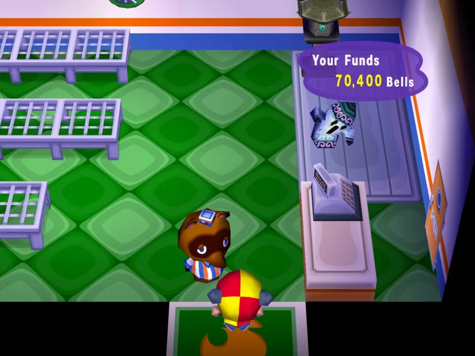
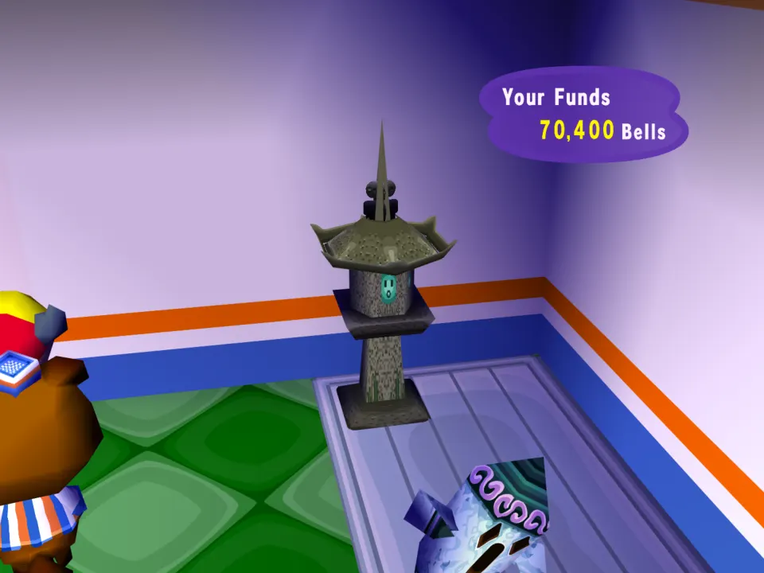
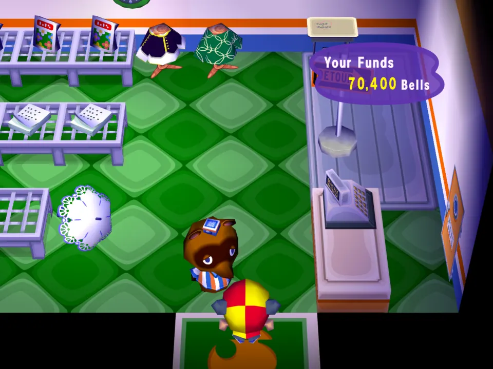
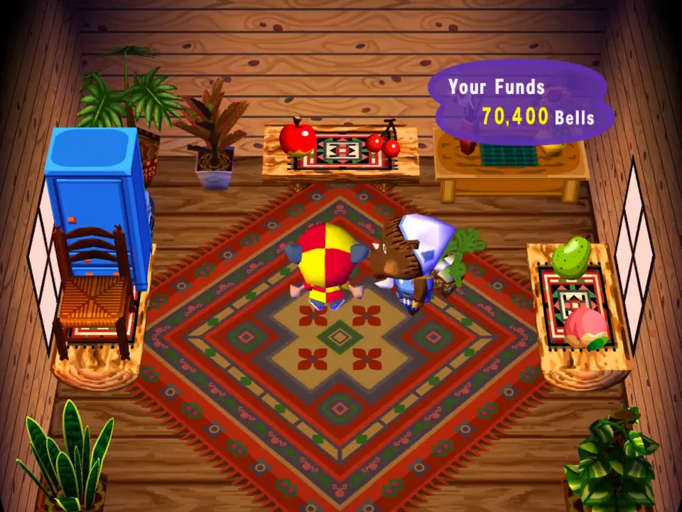

# After Hours

A World mod (`"scope": "world"`) in two halves:

- **The shop** (`shops.json`): from 1 AM to 3 AM the town shop opens again,
  and all it sells is gyroids, a different few each night. Every other spot
  is empty.
- **The lantern** (`items.json`, `items/ghost-lantern/`): the Ghost Lantern,
  a tall lantern of the mod's own with its own pictures. Now and then it
  stands among the gyroids.

A shop changes the town, so the mod is a World mod.

## In the game

1:20 AM in the rain: the town shop is lit and open, hours after it would usually shut.

Inside at night every shelf is bare. The only goods are by the counter: tonight a Ghost Lantern and a gyroid.

The Ghost Lantern, the mod's own piece: a tall lantern with green glowing windows, a face in them, and moss down its stone. Only this lantern wears these pictures.

The same shop at 10 AM: the day's own goods on every shelf. The mod changes nothing outside its hours.

The film (click the picture): Inside the shop at 1:20 AM with the mod: empty shelves, and by the counter only tonight's gyroid and the Ghost Lantern.

## The shop

`shops.json` changes one shop, Nook's store, by its id `"nook"`. Its block says
when it applies, what it does then, and its sixteen goods: fifteen gyroids and
the Ghost Lantern.

- `"when": { "hours": { "from": "01:00", "to": "03:00" } }`: the block applies
  only inside these hours.
- `"open": true`: while it applies the shop is open, even though it is shut at
  night.
- `"own_goods": false`: while it applies the mod's goods are the shop's whole
  stock. Each furniture spot holds one of them and every other spot is bare.
  Without it the goods would join the day's own instead.
- Outside the hours nothing changes. The shop keeps its own hours and its own
  goods, and the day's stock is still there when it opens in the morning.
- The shop has fewer furniture spots than sixteen goods, so it shows a few of
  them each night, and a different few the next night. The Ghost Lantern is
  one of the sixteen, so it is there only on some nights.
- A good may be an item of the same mod, named by its full id,
  `example.after-hours:ghost-lantern`. Without a `price` it takes the item's
  own price from `items.json`. The gyroids sell at the game's own price.
- Every shop takes the same fields with the same meaning. The same block works
  on the flower shop as `"flower"`.

## The lantern

`items.json` lists the new item. It has an `id`, a `name`, a `price`, a `base`
(the game's own piece it is built on, here the tall lantern) and `textures`,
a folder of pictures only this item draws.

- The pictures in `items/ghost-lantern/` are named like texture mod files,
  after the base's textures. Only the Ghost Lantern wears them: a tall lantern
  next to it keeps its own look. Four of the lantern's textures are replaced,
  the windows and the stone beside them, and the rest stay the base's.
- A gyroid cannot be a base, so the mod's own piece is a lantern.
- With the mod installed, the piece is the mod's item, with its own name.
- Remove the mod and the piece stays in the house as the plain base piece.
- Put the mod back and it is the mod's item again.

Other files name an item as `example.after-hours:ghost-lantern`: the mod id, a
colon, and the item id. Never change an item's id once players have it. To
rename one in a later version, map the old id to the new one with `"renames"`
in `mod.json`.

## Install

In Play AC Online, open the Mods tab. After Hours is in the mod list as an
official example: install it from there. Or download its ZIP from the
[cookbook](https://playaconline.com/modding/cookbook/) and add the file in the
Mods tab.

## Make your own

This repository is one mod, laid out the way the GitHub import wants it:
`mod.json` at the top, and a tag named for the version in `mod.json`.

1. Copy the repository to your own account.
2. Change `"id"` in `mod.json` to your own, like `yourname.after-hours`, and
   the full ids in `shops.json` with it. Ids that start with `example.` are
   kept for these examples, so the import refuses them.
3. Tag the commit with the version, like `v1.0.0`.
4. Push the commit and the tag. Then, in the game, open **Settings**, then
   **Mods**, and scroll to **Share a mod**. Sign in, answer the age question
   and accept the mod rules the first time, and type the code from your
   authenticator app. **Import from GitHub** shows under the upload form once
   the code is accepted. Paste `github.com/<you>/<repository>@v1.0.0` there
   and choose **Import**.

To keep only one half, delete the other half's files and its lines in
`mod.json`, and `playac-mod check` tells you if anything still points at them.

The modding guide is at [playaconline.com/modding](https://playaconline.com/modding/).

`media/` holds the pictures and the film the cookbook shows, with their
captions in `media/media.json`. `.playac/screenshots/` holds the listing's
screenshots.

What goes in the mod's ZIP is decided by the pack rule, the same for
`playac-mod pack` and the GitHub import:

- Left out: this repository's own files. Those are this `README.md`,
  `CHANGELOG.md` (it is sent beside the ZIP as the listing's changelog),
  `LICENSE`, the whole `media/` folder with its pictures, film and
  `media.json`, and the screenshots (`.playac` starts with a dot). The game
  ignores the same files in any ZIP.
- Kept: every other `.json`, `.lua`, `.dds`, `.png`, `.txt` and `.md` file.

## License

MIT, see [LICENSE](LICENSE).
